# MacShell-niri

English · [Русский](README.ru.md)

A macOS-inspired desktop for **niri**, with a Dock, Spotlight and Liquid Glass.

[Get started](#get-started) · [Gallery](#a-closer-look) · [Guides](#guides)

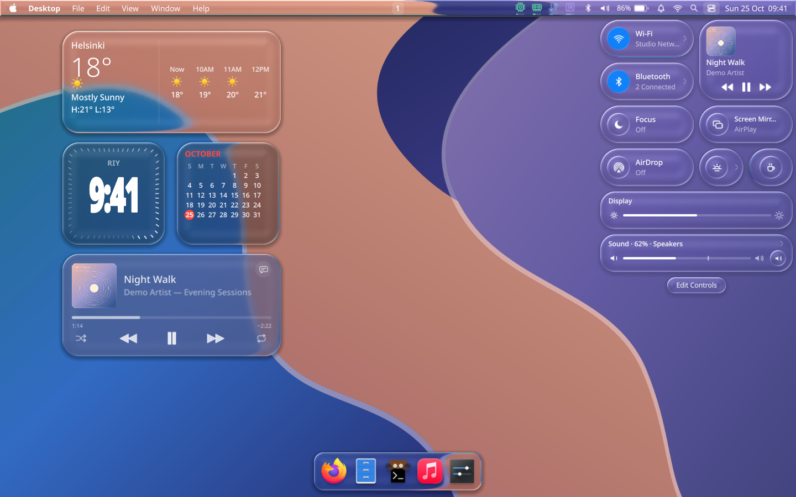

[Light theme](docs/images/showcase-cc-light.png) · Demo data and stronger glass for the showcase. [Behind the screenshots](docs/SCREENSHOTS.md).

## In motion

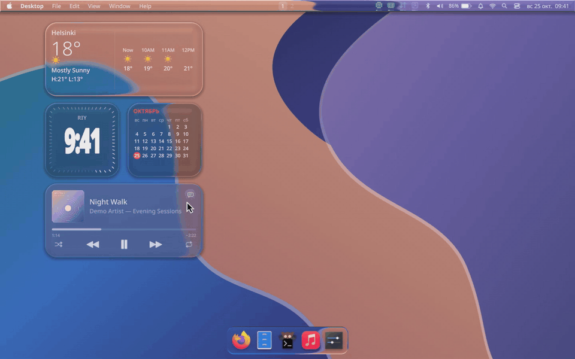

[Watch in 30 fps](docs/images/showcase-demo.mp4)

## A closer look

**Find what you need**

| Dark | Light |
| --- | --- |
| <a href="docs/images/showcase-detail-spotlight-dark.png">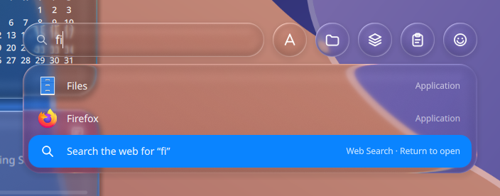</a> | <a href="docs/images/showcase-detail-spotlight-light.png">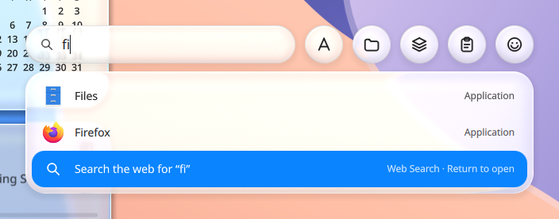</a> |

**Arrange your widgets**

| Dark | Light |
| --- | --- |
| <a href="docs/images/showcase-detail-widgets-dark.png">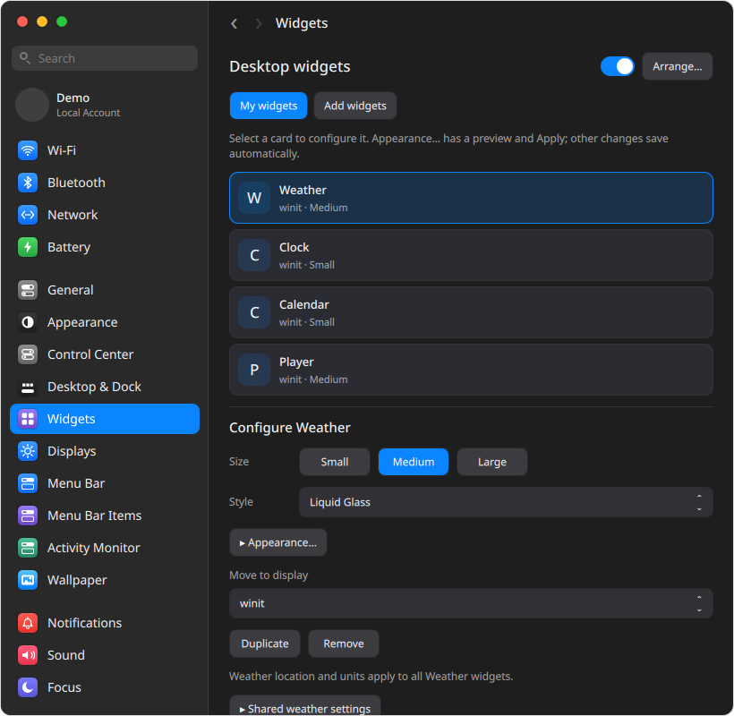</a> | <a href="docs/images/showcase-detail-widgets-light.png">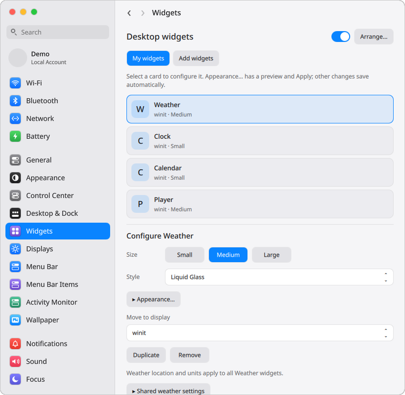</a> |

**A glance at your system**

| Dark | Light |
| --- | --- |
| <a href="docs/images/showcase-detail-stats-dark.png">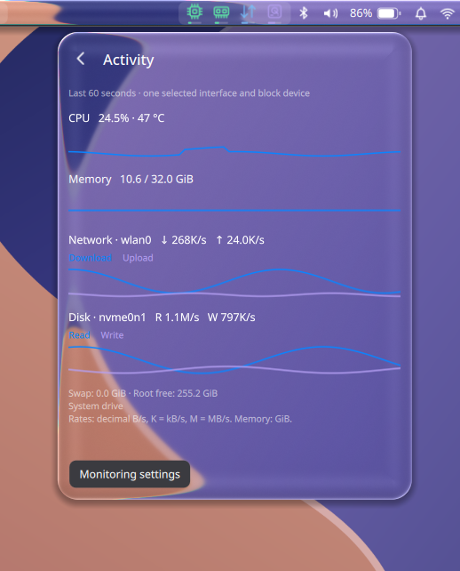</a> | <a href="docs/images/showcase-detail-stats-light.png">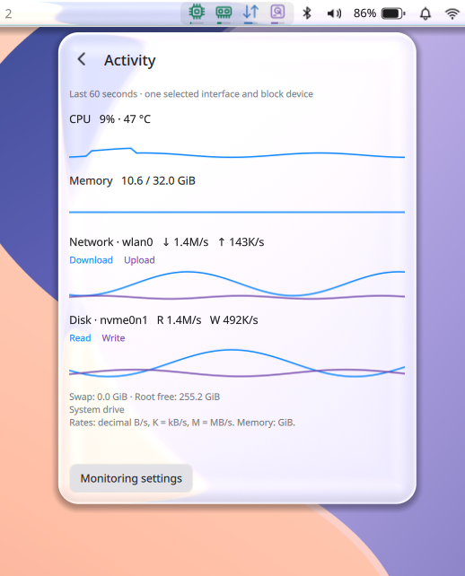</a> |

<details>
<summary>More screenshots</summary>

**Applications**

| Dark | Light |
| --- | --- |
| <a href="docs/images/showcase-detail-apps-dark.png">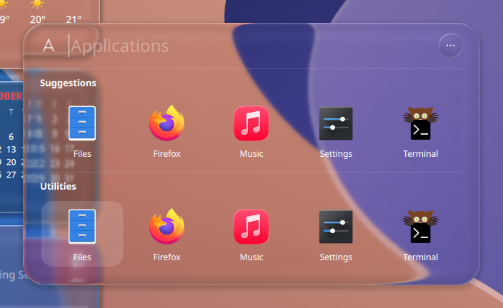</a> | <a href="docs/images/showcase-detail-apps-light.png">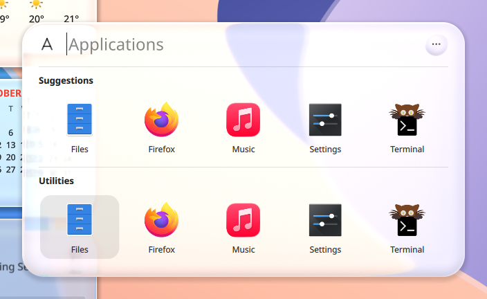</a> |

**Wi-Fi**

| Dark | Light |
| --- | --- |
| <a href="docs/images/showcase-detail-wifi-dark.png">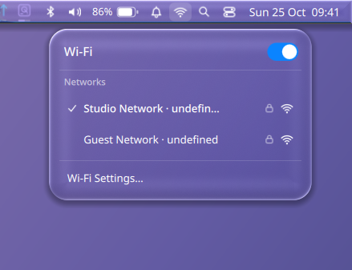</a> | <a href="docs/images/showcase-detail-wifi-light.png">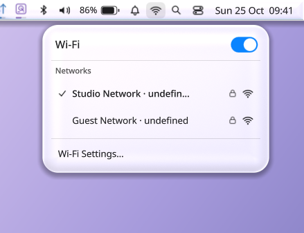</a> |

**Bluetooth**

| Dark | Light |
| --- | --- |
| <a href="docs/images/showcase-detail-bt-dark.png">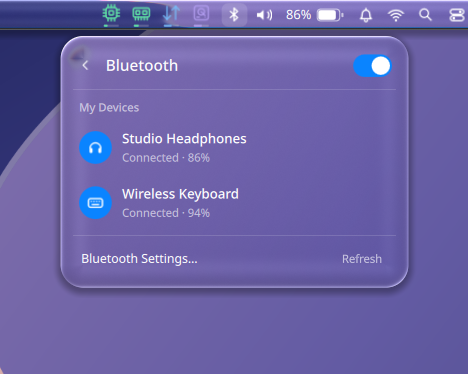</a> | <a href="docs/images/showcase-detail-bt-light.png">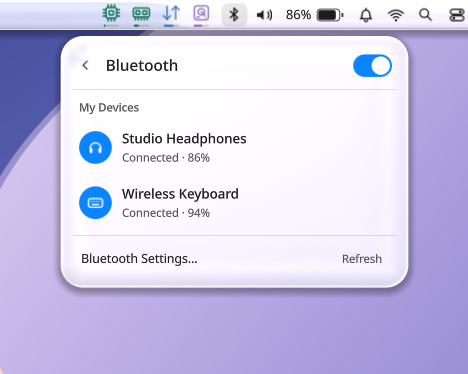</a> |

**Sound**

| Dark | Light |
| --- | --- |
| <a href="docs/images/showcase-detail-vol-dark.png">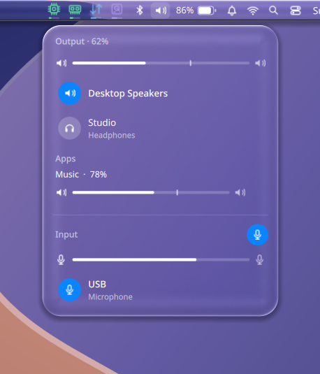</a> | <a href="docs/images/showcase-detail-vol-light.png">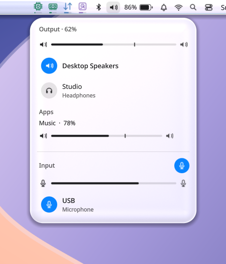</a> |

**Battery**

| Dark | Light |
| --- | --- |
| <a href="docs/images/showcase-detail-battery-dark.png">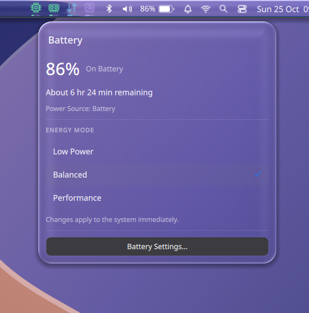</a> | <a href="docs/images/showcase-detail-battery-light.png">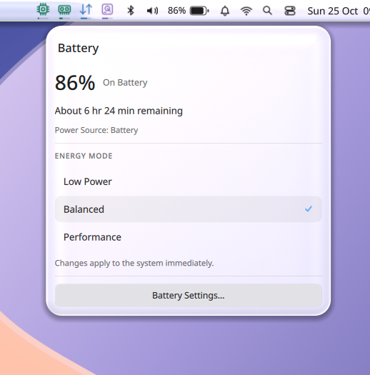</a> |

**World Clock**

| Dark | Light |
| --- | --- |
| <a href="docs/images/showcase-detail-clock-dark.png">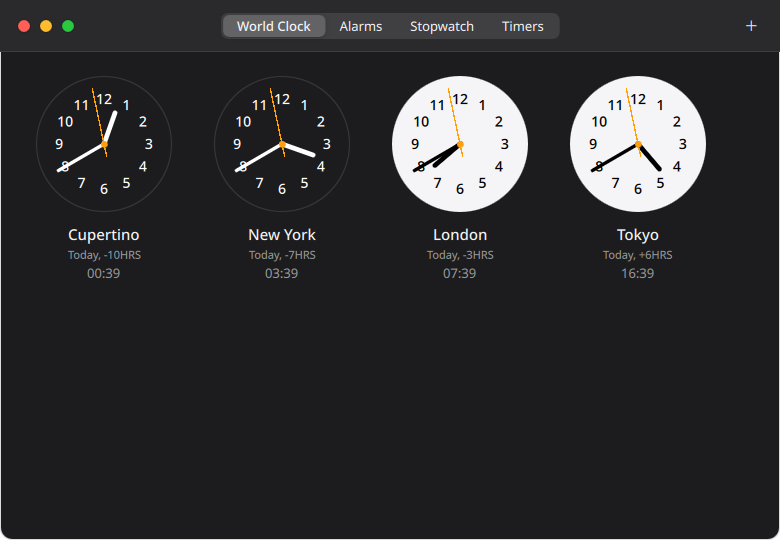</a> | <a href="docs/images/showcase-detail-clock-light.png">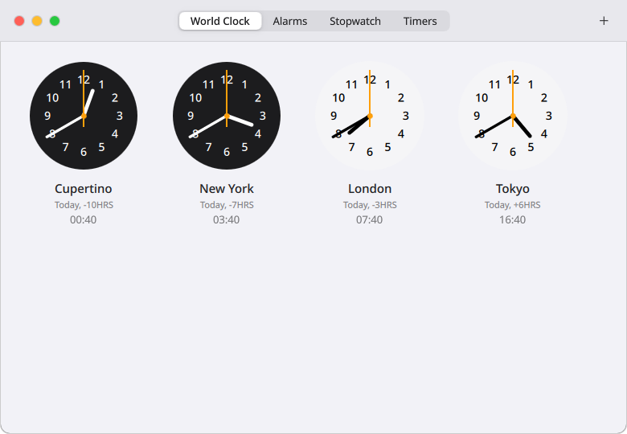</a> |

**Menu bar**

| Dark | Light |
| --- | --- |
| <a href="docs/images/showcase-detail-barlayout-dark.png">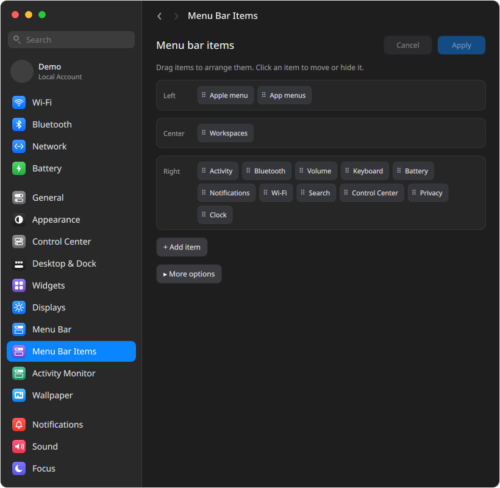</a> | <a href="docs/images/showcase-detail-barlayout-light.png">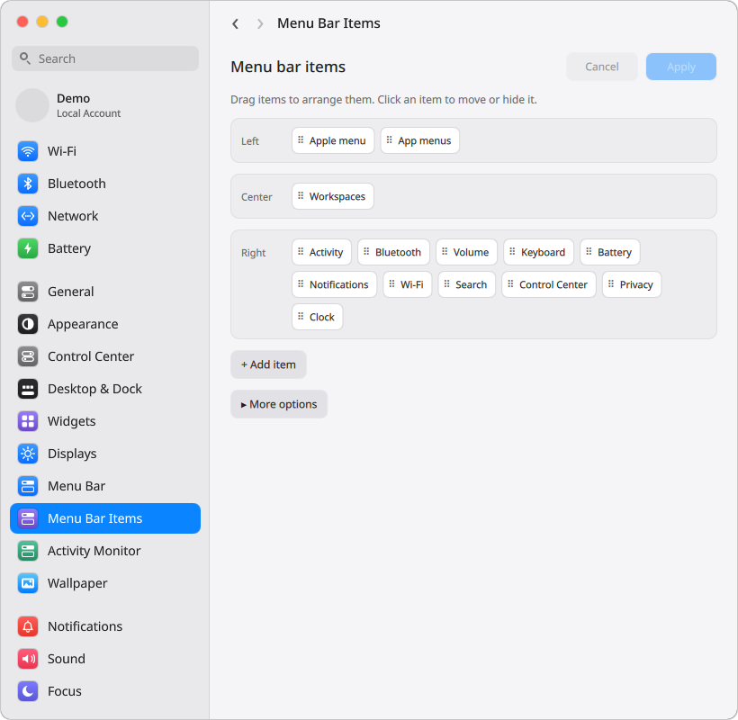</a> |

**Desktop**

| Dark | Light |
| --- | --- |
| <a href="docs/images/showcase-desktop-dark.png"></a> | <a href="docs/images/showcase-desktop-light.png">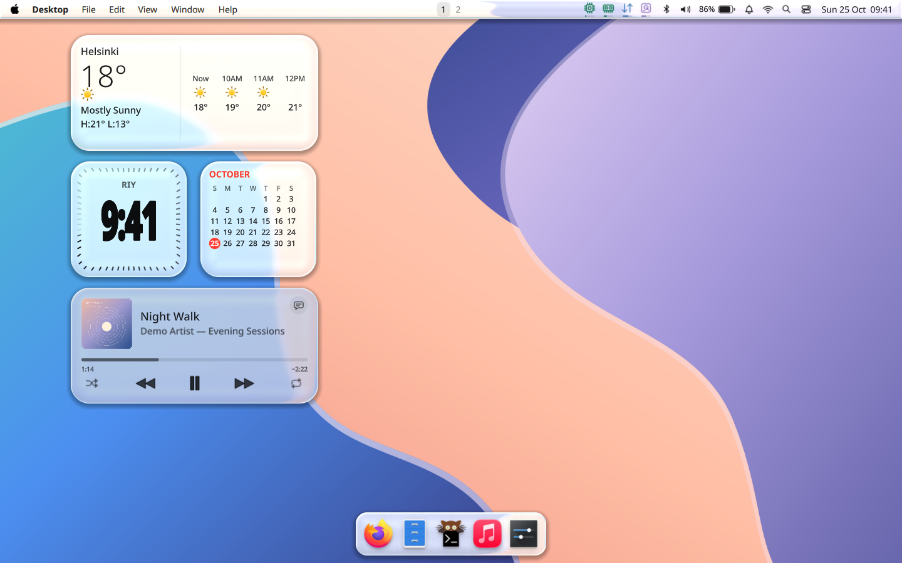</a> |

**Control Center**

| Dark | Light |
| --- | --- |
| <a href="docs/images/showcase-cc-dark.png"></a> | <a href="docs/images/showcase-cc-light.png">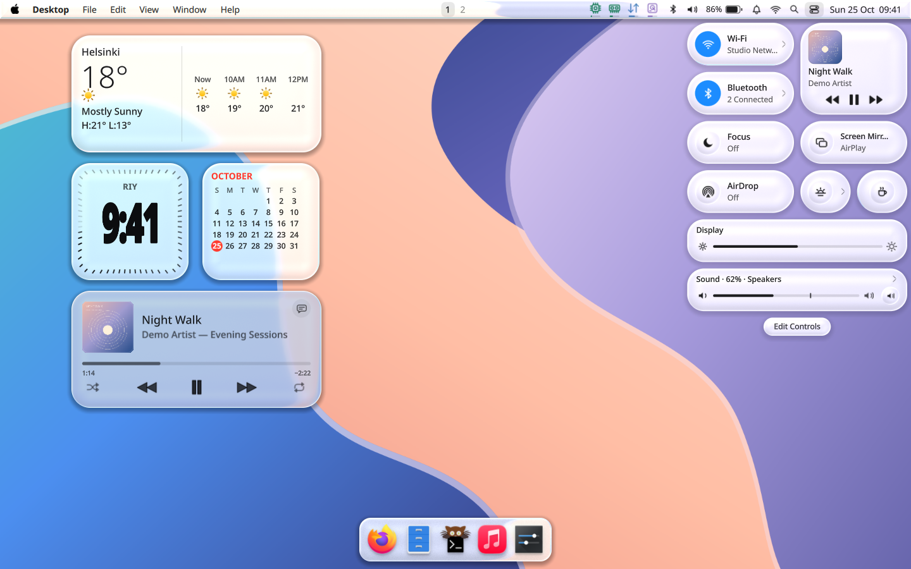</a> |

</details>

## Get started

Requires niri 26.04+, Qt 6.9+ and a compatible Quickshell build.

```bash
git clone https://github.com/frithTK/MacShell-niri.git
cd MacShell-niri
bash install.sh --check
```

Then follow the [installation guide](docs/INSTALL.md) to add a **Niri (MacShell)** login session. It also covers updates, backups and rollback.

## Guides

[Widgets](docs/WIDGETS.md) · [Menu bar](docs/BAR_LAYOUT.md) · [Activity](docs/ACTIVITY_SETTINGS.md) · [Control Center](docs/CONTROL_CENTER.md) · [MacLock](MacLock/README.md)

[AirPlay](docs/CONTROL_CENTER.md#повтор-экрана--airplay) and [AirDrop](docs/AIRDROP.md) need additional components; see the guides for setup and compatibility.

[Release 1.0.0](https://github.com/frithTK/MacShell-niri/releases/tag/v1.0.0) · [Performance](docs/PERFORMANCE.md) · [Roadmap](docs/CUSTOMIZATION_PROGRESS.md) · [IPC](docs/IPC.md) · [Contributing](CONTRIBUTING.md) · [Security](SECURITY.md) · [Changes](CHANGELOG.md)

---

Based on [MacShell by 0-ss / Rickky](https://github.com/0-ss/MacShell). niri port by [frithTK](https://github.com/frithTK). [MIT](LICENSE) · [Third-party notices](THIRD_PARTY_NOTICES.md)

[](https://github.com/frithTK/MacShell-niri/actions/workflows/ci.yml)
