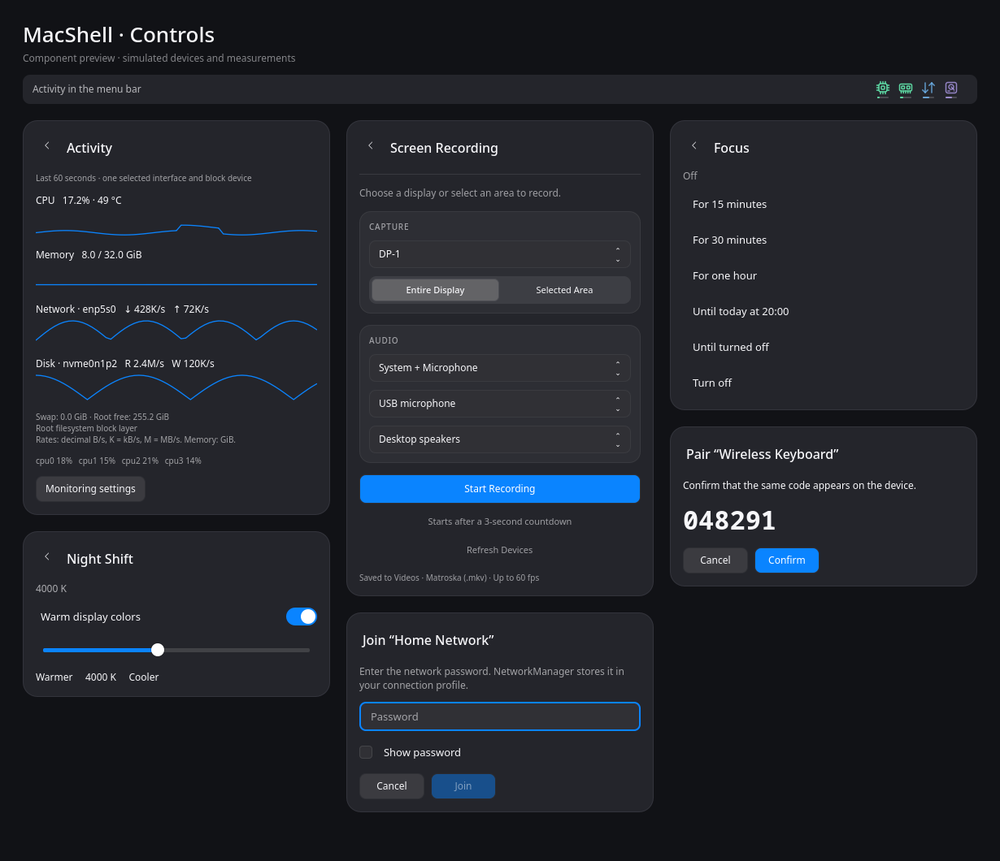

# Панель и Control Center

## Мониторинг ресурсов

В верхней панели перед треем находятся четыре значка: процессор, память, сеть и диск. Тонкая полоска под каждым показывает нагрузку или активность. Для CPU и памяти зелёный означает менее 65%, жёлтый — от 65%, красный — от 90%. Сеть подсвечивается синим, диск — фиолетовым: яркость и полоска отражают интенсивность обмена по логарифмической шкале, а не процент пропускной способности. Отсутствующие и устаревшие данные отображаются нейтральным цветом.

При наведении на значок появляются точные значения: CPU, занятая память, приём/передача сети или чтение/запись диска. Нажатие открывает графики за последнюю минуту, нагрузку отдельных ядер, swap, свободное место корневой файловой системы и температуру CPU при наличии датчика.

В Settings → Menu Bar → Activity Monitor можно выбрать показатели, формат памяти, интервал обновления 1/2/5 секунд, сетевой интерфейс и блочное устройство. Автоматический выбор сети использует физический интерфейс; VPN можно выбрать вручную. Автоматическое определение диска поддерживает корневой Btrfs с одним устройством, включая подтомы с виртуальным st_dev. Для сложных схем хранения доступен ручной выбор уровня дисковой активности; несколько уровней стека не суммируются.

Четыре значка занимают 120 пикселей при стандартном масштабе панели. При нехватке места расстояния сокращаются до 92 пикселей, затем блок сворачивается в один значок Activity с общей подсказкой. Его цвет в первую очередь отражает нагрузку выбранных CPU/RAM. Кнопка Open monitoring в настройках доступна и при скрытом блоке. Настройка формата памяти меняет подсказку: GiB или проценты; скорости — в десятичных единицах B/s, kB/s и MB/s.

Примеры с демонстрационными данными: [значки в тёмной теме](images/activity-dark.png), [в светлой](images/activity-light.png); графики [в тёмной](images/stats-menu-dark.png) и [светлой](images/stats-menu-light.png) темах. Чтение/приём показаны синим, запись/отправка — фиолетовым. Запись видна и при нулевом чтении.

Для диагностики: `macshell-niri ipc call monitoring state` показывает устройство, интервалы, свежесть и реальные значения. `monitoring open` / `monitoring close` открывают/закрывают Activity. Первый delta-сэмпл после запуска, смены устройства или пробуждения ещё не содержит скорости.


В **Settings → Activity Monitor** доступны собственные пороги CPU/RAM, монохромные значки, порядок метрик и двоичные единицы скорости. Изменения сначала видны в предпросмотре и применяются кнопкой Apply. Поиск Settings находит эти параметры по названиям и русским ключевым словам. Подробности — в [руководстве настроек Activity](ACTIVITY_SETTINGS.md).

## Wi-Fi

Круглая кнопка Wi-Fi включает или выключает радио, подпись открывает список сетей. Из Control Center список остаётся внутри той же панели: кнопка назад и Escape возвращают в Пункт управления, длинный список прокручивается. Значок Wi-Fi в меню-баре по-прежнему открывает отдельное меню. Для новой защищённой сети появится диалог пароля; тот же диалог открывает Join… в Settings → Wi-Fi.

Поддерживаются открытые сети и WPA2/WPA3 Personal. Для Enterprise, OWE и WEP используйте расширенные настройки NetworkManager. Пароли сохраняются в профиле NetworkManager, а не в настройках MacShell. При неверном пароле можно повторить ввод или отменить подключение.

## Bluetooth

Круглая кнопка Bluetooth переключает питание, подпись со стрелкой открывает устройства. Из Control Center список тоже встраивается в панель Пункта управления (назад сохраняет якорь панели); значок Bluetooth в верхней панели открывает отдельное меню. Нажатие на известное устройство подключает или отключает его; заряд показывается, если устройство его передаёт.

Find new devices… запускает поиск на включённых адаптерах на 30 секунд. Выберите Pair у найденного устройства, затем введите PIN, наберите показанный код на клавиатуре или подтвердите совпадение кодов. Успешно сопряжённое устройство подключается и получает разрешение на автоматическое повторное подключение. Запрос можно отменить.

## Звук

Заголовок Sound показывает выбранный выход и открывает выбор аудиовыхода, микрофона, выключение микрофона и громкость отдельных приложений.

Громкость выхода и приложений регулируется от 0 до 150%. Клавиши громкости меняют её на 5 процентных пунктов, колесо над значком звука — на 3. Ползунки Sound, меню звука и Settings → Sound поддерживают усиление выше 100%; отметка на ползунках меню и Control Center соответствует 100%. Процент в меню, настройках и экранном индикаторе показывает фактический уровень, включая 101–150%.

## Focus и Keep Awake

Значок Focus переключает режим «не беспокоить», а подпись открывает выбор срока. Значок Keep Awake открывает меню длительности предотвращения автоматического idle.

Доступны 15, 30 и 60 минут, до 20:00 и до ручного выключения. После 20:00 предлагается следующий вечер. Длительность учитывает время сна компьютера. Ручное выключение отменяет таймер; Lock и Suspend остаются доступны. Keep Awake не переносится автоматически в новую сессию входа.

## Night Shift

Нажатие на значок Night Shift сразу включает или выключает тёплые цвета. Стрелка справа открывает температуру 2500–6000 K; те же настройки доступны в Settings → Displays. Выбранная температура и включение сохраняются между запусками. При смене температуры показывается Applying до отправки новой gamma-таблицы, после — применённая температура. Кнопка повторной попытки появляется только при ошибке.

Для работы нужен `wlsunset` и поддержка Wayland gamma-control. Достаточно наличия программы в PATH оболочки, в том числе в пользовательском `~/.local/share/macshell-niri/runtime/bin`: отдельный автозапуск, геолокация и настройка расписания не нужны. Отсутствие программы или конфликт с другим менеджером цвета отображаются в меню. Проверка состояния: `macshell-niri ipc call nightshift state`.

## Повтор экрана / AirPlay

Для передачи файлов добавлена отдельная плитка [AirDrop](AIRDROP.md), с ручным включением и подтверждением входящих запросов.

Плитка **Screen Mirroring** добавляется в Control Center при первом обновлении. Её можно переместить или удалить через Edit Controls; после удаления она не добавляется повторно. В меню две вкладки:

- **Send Screen**: поиск Apple TV, Mac и совместимых AirPlay-телевизоров в локальной сети. Выберите устройство; при запросе введите код с экрана или пароль AirPlay. На Wayland системный диалог позволяет выбрать монитор или окно. **Stop Mirroring** завершает передачу, **Cancel Connection** отменяет соединение, **Send system audio** управляет звуком активной трансляции.
- **Receive AirPlay**: задайте имя компьютера и нажмите **Enable AirPlay Receiver**. На iPhone/iPad/Mac откройте «Повтор экрана» и выберите это имя. Код для подключения отображается в меню MacShell. Изображение и звук принимает UxPlay; видео открывается в отдельном окне. **Stop AirPlay Receiver** выключает приём.

Нужны отдельно установленные [Doubletake](https://github.com/omarroth/doubletake) для передачи и [UxPlay](https://github.com/FDH2/UxPlay) для приёма. Утилиты ищутся в PATH и `~/.local/share/macshell-niri/runtime/bin` с учётом XDG_DATA_HOME. Нужны зависимости GStreamer этих программ: H.264-кодировщик для передачи, декодеры H.264/AAC/ALAC, `waylandsink` и `pipewiresink` для приёма; стабильный UxPlay 1.73.x использует Avahi/Bonjour. Для передачи в Wayland нужны рабочие PipeWire и ScreenCast portal. Устройства должны находиться в одной локальной сети; совместимость конкретного телевизора определяется backend. Приём защищён PIN. DRM-видео UxPlay не поддерживает.

В Settings → Screen Mirroring доступны частота кадров передачи (по умолчанию 60 FPS, максимум 60) и громкость телевизора при подключении (по умолчанию 20%). Эти параметры применяются к следующему подключению. Для корректной громкости нужен Doubletake runtime с опцией `-volume-percent`; подробности и проверка — в [DOUBLETAKE_RUNTIME.md](DOUBLETAKE_RUNTIME.md). Старый Doubletake при значении ниже 100% блокируется с понятной ошибкой, чтобы не подключать ТВ на 100%.

Отсутствие одного backend не отключает второе направление. Установщик показывает отсутствующие программы как необязательные и не устанавливает их автоматически.

Состояние «передача» подтверждается ответом Doubletake, «приём доступен» — публикацией сервиса UxPlay, входящая трансляция — событиями его медиапотока. Во время исходящего подключения и передачи захват превью и фона стекла приостанавливается. Поиск прекращается после закрытия меню, если активного подключения нет. Приёмник не включается автоматически после входа. Выход из MacShell завершает только запущенные им экземпляры программ.

Имя приёмника сохраняется в настройках оболочки; PIN и пароли туда не записываются. Doubletake хранит сопряжение в `$XDG_CONFIG_HOME/macshell-niri/airplay/credentials.json`, ключ приёмника — `receiver.pem` в том же каталоге.

### iPhone видит приёмник, но не подключается

Обнаружение через mDNS не подтверждает доступность портов трансляции. Если ошибка возникает ещё до запроса кода, проверьте входящие соединения в сетевом экране. MacShell запускает UxPlay с фиксированными **7100–7102 TCP и UDP** (`-p 7100`); прежняя версия выбирала случайный порт. mDNS использует **5353/UDP**. Не отключайте firewall: разрешите нужные порты для телефона или доверенной локальной сети на нужном интерфейсе.

iOS может подключаться по **IPv6 link-local**, даже если устройства имеют IPv4-адреса. Правило только для IPv4 не разрешает такое соединение. Пример UFW для одного телефона (замените интерфейс и адрес на свои):

```bash
sudo ufw allow in on wlan0 proto tcp from fe80::1234:5678:abcd:ef01 to any port 7100:7102 comment 'MacShell AirPlay phone'
sudo ufw allow in on wlan0 proto udp from fe80::1234:5678:abcd:ef01 to any port 7100:7102 comment 'MacShell AirPlay phone'
```

Для подключения по IPv4 нужны соответствующие правила с IPv4-адресом телефона или доверенной подсетью. После смены сети/адреса узкие правила следует обновить; они не применяются автоматически. Изоляция клиентов на точке доступа также может мешать приёму. MacShell не меняет firewall при включении приёмника.

Если порты заняты другим экземпляром UxPlay, приёмник покажет ошибку и не перейдёт на случайные порты. Остановите другой приёмник и повторите запуск. Диагностика без раскрытия PIN: `macshell-niri ipc call mirroring state` возвращает `receiverError` и `receiverAwaitingCode`; состояние `waiting` означает публикацию сервиса, `streaming` — начало медиапотока. Изображение и звук с физического iPhone проверяются отдельным подключением.

Если код появляется, но после ввода спрашивается снова, проверьте версию UxPlay: для 1.73.7 подготовлены [патч проверки PIN и протокольный тест](UXPLAY_RUNTIME.md). Замена QML не обновляет внешний backend автоматически.

Примеры меню с демонстрационными устройствами: [тёмная тема](images/airplay-dark.png), [светлая тема](images/airplay-light.png). Это иллюстрации интерфейса, а не подтверждение трансляции на реальное устройство.

## Запись экрана

Значок Record открывает выбор монитора или области, а также звука: без звука, системный, микрофон или их смесь. Для захвата звука выберите конкретные устройства. После нажатия Start идёт отменяемый отсчёт три секунды. Повторное нажатие значка Record останавливает запись.

Область должна полностью помещаться на выбранном мониторе. Для выделения нужен `slurp`, для записи — `wf-recorder` и `ffprobe`, для смеси — `pw-loopback`. Выбор источника звука использует `pw-dump`. Поддерживаются динамические Linux-сборки recorder с PipeWire backend либо PulseAudio backend через `pipewire-pulse`; во втором случае также нужен `pactl`. Название backend в `wf-recorder --help` не доказывает, что он включён в сборку. Неизвестные, статические или обёрнутые сборки для записи звука требуют поддерживаемого исполняемого файла; без звука эта проверка не нужна.

MacShell выбирает доступный backend по библиотекам исполняемого файла. Для PulseAudio выбранный PipeWire sink сопоставляется с его monitor-source, микрофон/виртуальный source — с конкретным source. Системный источник по умолчанию не подставляется. Проверки PID recorder и фактических соединений с выбранным устройством продолжают действовать.

Запись идёт с постоянной частотой 60 кадров/с, включая неподвижный экран. Начало подтверждается видеопакетом в журнале muxer: небольшая запись может оставаться в памяти recorder и ещё не увеличивать файл. При ожидании звука показывается отдельная ошибка аудиоподключения, а `No video frames arrived` означает отсутствие подтверждённого видеопакета. Это десятисекундная проверка запуска, а не ограничение длины записи.

Файлы с уникальными именами сохраняются в `~/Videos` в формате Matroska (`.mkv`). При потере устройства или ошибке завершения частичный файл сохраняется с сообщением об ошибке.

Нативная проверка без захвата рабочего содержимого: `python3 scripts/check-recording-native.py`. Она записывает собственную непрозрачную карточку и отдельные виртуальные аудиоузлы, проверяет четыре режима звука дольше прежнего таймаута и остановку при удалении тестового источника. Реальные микрофон и звук приложений не используются, временные файлы и узлы удаляются. `--installed` проверяет установленную копию backend; `--modes none system` сокращает прогон. Это намеренный тест в активной сессии, не фоновая проверка.

## Индикаторы клавиш громкости и яркости

Клавиши громкости, выключения звука, микрофона и яркости показывают стеклянный индикатор справа сверху: значок, уровень в процентах и шкалу; при выключенном звуке — Muted. Он остаётся виден поверх полноэкранных приложений, не перехватывает мышь и клавиатуру и скрывается через 1,5 секунды после последнего нажатия. Ползунки Control Center не вызывают дополнительный индикатор.

Сочетания клавиш в niri должны вызывать IPC MacShell: `macshell-niri ipc call volume increase`, `volume decrease`, `volume muteOutput`, `volume muteInput`, `brightness increase` и `brightness decrease`. Команды громкости используют PipeWire, яркости — `brightnessctl`. При миграции соответствующие привязки Noctalia заменяются автоматически; собственные привязки niri сохраняются. Текущее состояние индикатора: `macshell-niri ipc call osd state`.

Примеры с демонстрационными уровнями: [тёмная тема](images/osd-dark.png), [светлая тема](images/osd-light.png).

## Батарея и питание

Нажатие на значок батареи открывает отдельное меню с процентом заряда, источником питания и приблизительным временем работы. Во время зарядки показывается оценка времени до полного заряда, при полном заряде — Fully Charged. Если UPower ещё не рассчитал прогноз, отображается Calculating time; нулевое время не выдаётся за готовую оценку. Краткая информация также доступна при наведении на значок.

В этом же меню и в Settings → Battery доступны Low Power, Balanced и Performance. Список возможностей берётся у power-profiles-daemon (также поддерживается совместимый сервис с прежним именем net.hadess.PowerProfiles). Недоступный профиль нельзя выбрать; ограничения производительности и ошибки переключения отображаются рядом. Выбор подтверждается фактическим состоянием системы и обновляется при внешнем переключении.

Game Mode временно запрашивает Performance через HoldProfile. Сервис питания управляет восстановлением профиля после завершения запроса, включая завершение процесса оболочки. Ручной выбор в меню отменяет запрос MacShell до следующего включения Game Mode. Возможности профилей зависят от оборудования и установленного системного сервиса; MacShell не устанавливает и не заменяет его автоматически.

## Оформление

Подменю Focus, Keep Awake, Night Shift, Activity, записи, пароля Wi-Fi и сопряжения Bluetooth используют общую тему, шрифт и элементы управления. Заголовки обычных подменю возвращают в Control Center; запросы пароля и сопряжения сохраняют явную отмену операции. Выбор доступен мышью и с клавиатуры.

В **Settings → Appearance** и **Menu Bar** основной выбор — **вид стекла**: Прозрачное / Обычное / Живое / Матовое. Это готовые сочетания размытия, тонировки и преломления; именные варианты держат размытие ниже порога половинного разрешения. Свои значения показываются как «Своё», пока снова не выберете готовый вид. Точные **Blur** (0–80), **Refraction** (0–250%) и тонировка спрятаны за **Дополнительно**. Значения общие для панели, Control Center и Dock и сохраняются между запусками.

**Blur** меняет радиус шейдерного размытия и настоящую силу фонового размытия niri. В niri эта настройка общая: она влияет также на другие приложения, запрашивающие размытие композитора. При первом перемещении ползунка MacShell создаёт собственный `macshell-blur.kdl` в активном профиле, проверяет полную конфигурацию и подключает файл. Остальные настройки, в том числе шум, насыщенность и явное отключение размытия в niri, сохраняются. До первой настройки справа показано **System**. Ноль снимает области размытия MacShell. Настройка доступна в активном отдельном профиле MacShell; произвольная конфигурация другой сессии не изменяется.

**Refraction** управляет линзой, увеличением и цветовыми искажениями только при работающем шейдерном преломлении. При Normal Blur, неподдерживаемой геометрии окон, записи или Game Mode ползунок недоступен; подпись объясняет текущее состояние. Размытие композитора не выдаётся за преломление. **Glass frosting / Translucency** меняет тонировку для читаемости.

Переключение Dock style применяется к Dock, сохраняя расположение и материал окна Settings. Текстура для преломления не рисуется отдельным фоном поверх приложений. Области размытия, радиусы углов и выборка шейдера учитывают масштаб панели, её точку привязки и анимации вложенных контролов.

При закрытии последнего меню область размытия сначала переносится за границы поверхности, а после двух отправленных кадров эффект полностью снимается. Это очищает оставшийся размытый силуэт после исчезновения контролов или Spotlight, включая быстрые переключения между меню. Постоянный невидимый эффект и перерисовка в простое не сохраняются.

[Сравнение до и после очистки](images/glass-close-cleanup.png) снято над тестовой сеткой после закрытия Spotlight. Регрессия `tests/glass-regions.qml` проверяет финальную отправку кадров, снятие временной области, отсутствие перерисовки в простое и повторное открытие до завершения очистки.

### Фон стекла в niri

Точное шейдерное преломление использует кадры окон через PipeWire и требует их экранных координат. На установленной версии niri координаты плиточных окон отсутствуют. Такие окна больше не исключаются незаметно с показом обоев: для этого монитора используется живое размытие настоящего содержимого под панелью через композитор. Это **размытие, а не линзовое преломление**. Когда все видимые окна имеют координаты, готовые кадры и не перекрывают друг друга, включается шейдерное преломление. При перекрытии окон порядок слоёв определяет композитор, поэтому используется его живое размытие.

Для живого размытия нужны Quickshell с BackgroundEffect и niri 26.04+. Профиль `config/macshell.kdl` задаёт `xray false` для слоёв MacShell: xray размывал бы только рабочий стол. При запуске в существующей сессии добавьте такое правило в её конфигурацию:

```kdl
layer-rule {
    match namespace="^mac(bar|barbg|dock|spot|switch|wall|osd)$"
    background-effect { xray false; }
}
```

Отключение превью Dock не отключает фон стекла. Во время записи PipeWire-захват для стекла приостанавливается и используется живое размытие композитора; в Game Mode эффекты отключаются. После завершения этих режимов источник выбирается заново. Проверить выбранный режим можно командой `macshell-niri ipc call glass state`.

Проверка в настоящей сессии: одно тестовое окно меняет цвет под уже открытым меню. [Живое размытие над плиточным окном](images/glass-live-tiled.png) и [шейдерное преломление над плавающим окном](images/glass-live-floating.png). Тестовое окно без личных данных запускается командой `qs -p tests/glass-live.qml`; цвет меняется через `qs -p tests/glass-live.qml ipc call probe phase 1`.

Для проверки координат есть окно `qs -p tests/glass-alignment.qml` с сеткой 48 px. Совмещение проверено при высоте панели 28, 34 и 52 px; переключение Dock style — без перезапуска, в обеих темах. Примеры живого размытия над сеткой: [тёмная тема](images/glass-controls-dark.png), [светлая тема](images/glass-controls-light.png). Команда `macshell-niri ipc call glass style dock liquid` переключает материал Dock, а `glass style dock blur` возвращает обычное размытие.

Для сравнения силы эффекта без закрытия меню: `macshell-niri ipc call glass tune blur 1`, затем `macshell-niri ipc call glass tune blur 80`. Команда `glass tune refraction 2.5` задаёт 250% линзы, когда она доступна. `glass state` показывает запрошенные значения и применённый уровень размытия niri. [Сравнение крайних значений](images/glass-tuning.png), настройки в [тёмной](images/glass-settings-dark.png) и [светлой](images/glass-settings-light.png) темах сняты в настоящей сессии над тестовой сеткой.

Пример меню батареи с демонстрационными данными: [тёмная тема](images/battery-dark.png), [светлая тема](images/battery-light.png).

Пример контролов с демонстрационными данными:



[Светлая тема](images/controls-light.png).

Светлая/тёмная тема и поведение прозрачной панели описаны в [APPEARANCE.md](APPEARANCE.md). Переключение из Control Center теперь синхронизировано с Dock, Settings, Clock и виджетами; тема сохраняется для следующего запуска.
