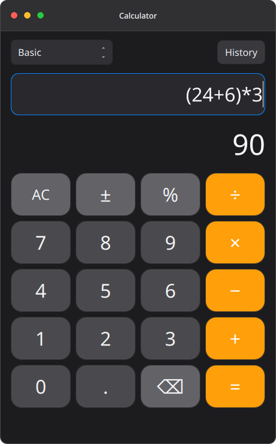
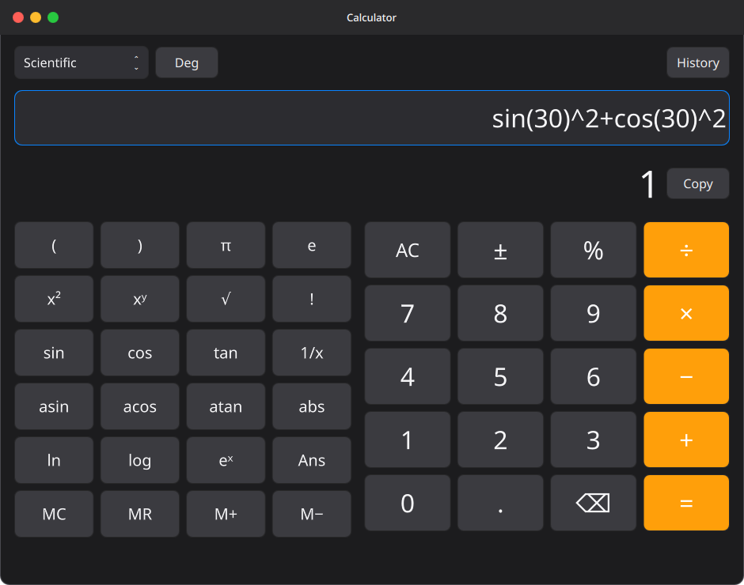
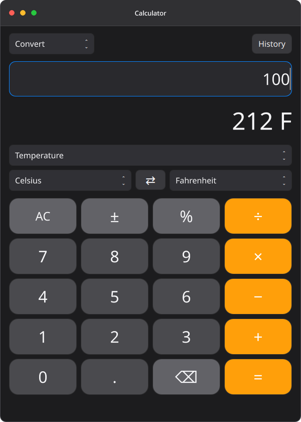
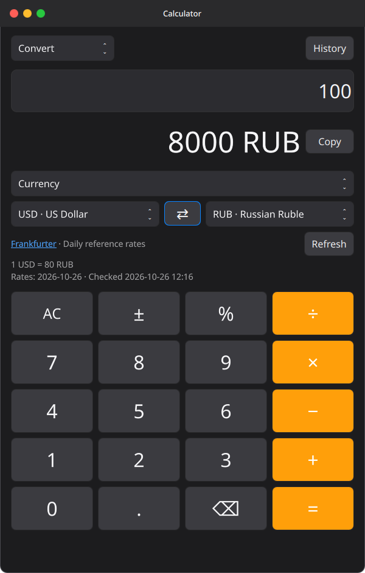
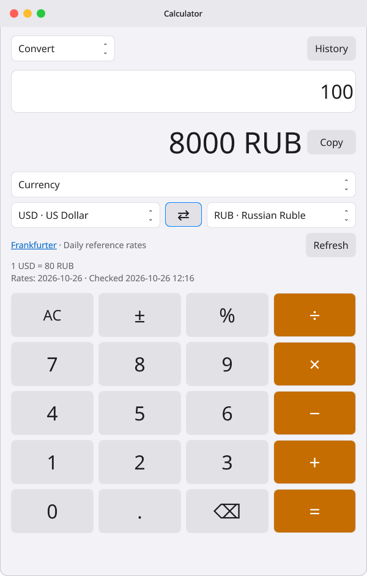
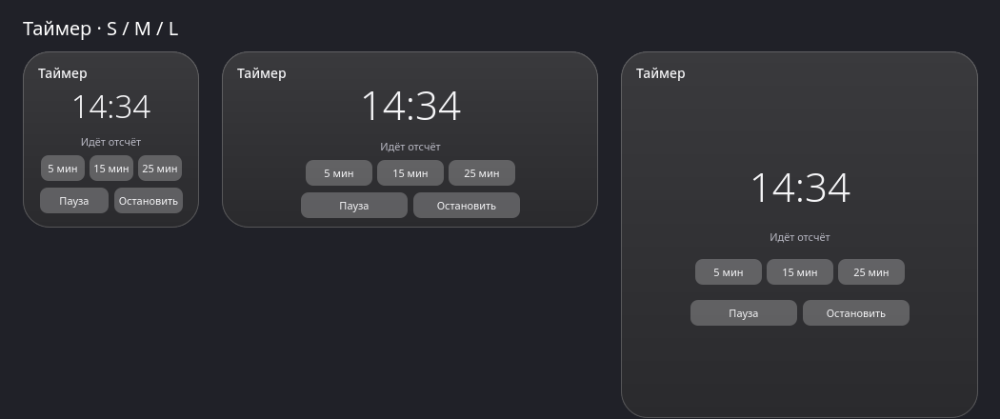
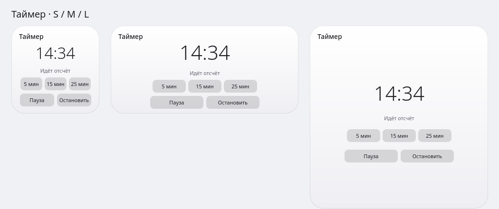
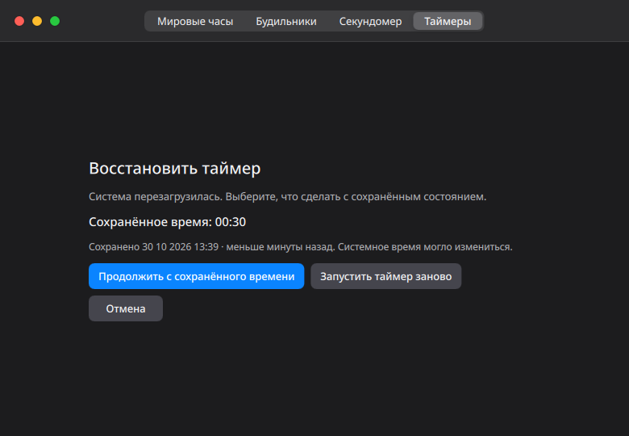
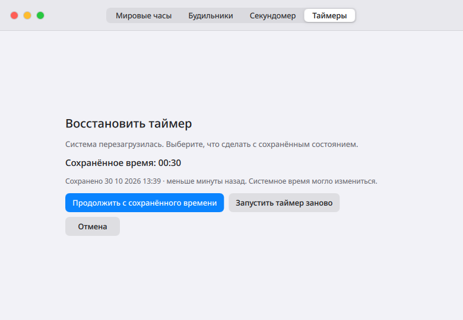

# Приложения и утилиты

**Calculator** и **Clock** доступны в **Apps → Utilities**, Spotlight и Dock. Поиск понимает `калькулятор`, `часы`, `таймер` и `будильник`. Запущенное приложение можно закрепить в Dock; утилиты имеют разные группы окон. Отключённый в Settings Clock не предлагается в Apps.

## Notes

Notes предоставляет локальные текстовые заметки: создание, редактирование, поиск по тексту, восстановление удалённых заметок и стандартные Undo/Redo редактора. Первая строка служит названием в списке. Открытие предусмотрено через Apps, Spotlight, Dock и `quickshell -c MacShell-niri ipc call notes open`. Поддерживаются светлая и тёмная темы, русский и английский интерфейс; Ctrl+F переводит фокус в поиск, Ctrl+N создаёт заметку.

До установки окно можно запустить отдельно из корня рабочего дерева: `~/.local/share/macshell-niri/runtime/bin/qs -d -p "$PWD/MacShell/notes-standalone.qml"`. Этот запуск использует ту же базу заметок, что и установленная версия. Окно работает как отдельный процесс и закрывается обычной кнопкой; интеграция в каталог и Dock появляется после штатного обновления оболочки.

Текст хранится отдельно от настроек оформления в `${XDG_DATA_HOME:-~/.local/share}/macshell/notes/notes.sqlite3`; доступ к файлу ограничен владельцем. SQLite записывает изменения транзакционно, при повторном открытии отображается последнее подтверждённое сохранение. Автосохранение начинается через 250 мс после ввода, а закрытие окна ожидает его завершения. При внезапном завершении процесса текст после последнего подтверждённого сохранения может быть потерян. Если запись не удалась, несохранённый текст остаётся в редакторе; можно повторить запись или сохранить его отдельной копией, не перезаписывая конкурирующее изменение. При неизвестной новой версии базы запись не выполняется.

Удаление можно отменить кнопкой «Вернуть заметку». Раздел «Недавно удалённые» позволяет восстановить и более ранние удаления, в том числе после закрытия приложения; автоматическая или безвозвратная очистка пока не предусмотрена. Форматированный текст, вложения, синхронизация, напоминания и виджет заметок относятся к последующим этапам. База заметок не входит в резервную копию установщика; для пользовательской резервной копии сохраняйте её отдельно, когда Notes закрыт.

Демонстрация на тестовых данных: [тёмная тема](images/notes-ru-dark.png), [светлая тема](images/notes-ru-light.png).

## Stickies / Записки

Stickies открывает компактные плавающие окна для быстрых записей. Создайте записку через Apps, Spotlight, Dock или `quickshell -c MacShell-niri ipc call stickies open`; кнопка `+` и Ctrl+N открывают ещё одно окно. В Notes кнопка с булавкой открывает выбранную заметку как записку; повторное нажатие переводит фокус на уже открытое окно.

До обновления оболочки отдельное окно текущей версии можно открыть из каталога проекта командой `bash scripts/open-stickies.sh`. Оно использует ту же базу Notes, что и установленная версия; Apps, Spotlight и Dock обновятся после штатной установки.

Текст записки хранится в той же базе, что и Notes, и появляется в списке заметок. В одной оболочке окна используют общую службу; изменения в открытых представлениях обновляются автоматически. Если одна и та же заметка одновременно изменена в двух редакторах, чужая версия не перезаписывается: несохранённый текст остаётся в окне, где его можно сохранить отдельной копией. Закрытие записки ожидает сохранения. Закрытая записка остаётся в Notes и оттуда может быть открыта снова. Оставленные открытыми окна восстанавливаются при перезапуске оболочки вместе с размером и положением; если прежний экран недоступен, окно откроется на доступном экране. Отдельный предпросмотр из checkout не восстанавливает окна оболочки. При внезапном завершении процесса могут потеряться изменения после последнего подтверждённого автосохранения.

[Записка с демонстрационным текстом](images/stickies-ru.png). Изменение цвета и размещение в desktop-виджетах остаются следующими этапами.

## Calendar

Calendar показывает месяц и события выбранного дня. Кнопка `+` создаёт разовое событие на весь день или с временем начала и окончания; события можно изменить, удалить и восстановить в разделе «Недавно удалённые». Длительное событие отображается на каждом дне, с которым пересекается. Момент окончания не входит в событие: закончившееся ровно в полночь не появляется на следующем дне. Первый день недели берётся из общей настройки MacShell.

До штатного обновления оболочки отдельное окно из текущего checkout можно запустить командой `bash scripts/open-calendar.sh`. Оно использует ту же базу календаря, что и установленная версия.

Время вводится в текущем местном часовом поясе. Несуществующее время при переходе часов и неоднозначный повторённый час не принимаются: выберите другое время. События со временем сохраняют абсолютные моменты и после смены часового пояса отображаются в новом местном времени; событие на весь день сохраняет календарную дату. Повторения, уведомления, импорт/экспорт ICS и синхронизация пока не реализованы. Существующий виджет календаря пока показывает только даты.

События хранятся в `${XDG_DATA_HOME:-~/.local/share}/macshell/calendar/events.sqlite3` отдельно от настроек; доступ к файлу ограничен владельцем. Изменения записываются транзакционно, а конфликт версий не перезаписывает другую редакцию. База не входит в резервную копию установщика; для пользовательской резервной копии сохраняйте её отдельно, когда Calendar закрыт.

## Reminders

Доступны локальные списки задач: создание, переименование и удаление списков, добавление и редактирование задач, отметка выполнения и поиск. Удалённые списки и задачи можно восстановить через «Недавно удалённые» после повторного открытия приложения; удаление списка скрывает и его задачи до восстановления. Системный список «Задачи» не удаляется. База находится в `${XDG_DATA_HOME:-~/.local/share}/macshell/reminders/tasks.sqlite3`, отдельно от заметок и оформления; доступ к ней ограничен владельцем. При конфликте ревизий другая запись не перезаписывается. После ошибки текст нового списка или задачи остаётся в поле.

Срок задаётся через «Изменить» у задачи: введите местные дату и время в формате `ГГГГ-ММ-ДД ЧЧ:ММ`. Пустое поле снимает срок. Несуществующее время и неоднозначный повторяющийся час при переводе часов отклоняются; ранее сохранённый момент при редактировании названия сохраняется. Момент хранится как абсолютное время и отображается в текущем местном часовом поясе.

Для срока можно выбрать повтор каждый день, неделю или месяц. При отметке задачи выполненной её срок переносится на следующее вхождение, а сама задача остаётся в списке. Повтор использует часовой пояс и местное время, действовавшие при настройке. При переходе часов пропущенное время переносится на первый существующий момент, повторённый час используется один раз; в последующие дни сохраняется исходное время. Для 29–31 числа в коротком месяце используется его последний день, а затем исходное число восстанавливается. Если задача выполнена с опозданием, прошедшие вхождения пропускаются и назначается первое будущее; отдельная история завершённых повторов пока не ведётся.

При наступлении срока служба отправляет системное уведомление, если задача и её список не удалены, а задача не выполнена. Закрытие окна не останавливает службу. Пропущенный во время остановки службы срок обрабатывается при её следующем запуске; смена системного времени не повторяет уже отправленное уведомление. После успешного принятия уведомления системным сервисом повтор не выполняется. Если процесс остановился во время отправки либо результат отправки неизвестен, приложение показывает «Доставка не подтверждена»: можно повторить её вручную или отметить обработанной. Если сам `notify-send` не удалось запустить, служба повторяет попытку через 30 секунд. Режим «Не беспокоить» и настройки системного сервиса могут скрывать уведомления.

Предварительный отдельный запуск работает только в текущем сеансе: после выхода или аварийного завершения процесса его необходимо запустить снова, чтобы обработать сохранённые сроки. После штатной установки служба запускается вместе с MacShell. Синхронизация, виджет и безвозвратная очистка удалённых записей пока не реализованы. База задач не входит в резервную копию установщика; для пользовательской резервной копии сохраняйте её отдельно, когда служба не работает. Перед миграцией версии базы создаётся отдельная резервная копия рядом с ней.

До установки можно открыть или повторно показать окно из корня рабочего дерева, не выходя из текущего сеанса: `bash scripts/open-reminders.sh`. Оно использует ту же базу, что и установленная версия; поиск в Apps/Spotlight и интеграция Dock появятся после штатного обновления MacShell. Снимки с демонстрационными данными: [тёмная тема](images/reminders-ru-dark.png), [светлая тема](images/reminders-ru-light.png).

## Calculator

Основная клавиатура использует цифры 32 px и кнопки высотой 72 px, результат — 48 px. Подписи научных функций — 20 px. Стандартные размеры окна: Basic 460×740, Scientific 940×740, Convert 600×840 (валюты — 600×940); при уменьшении окна содержимое прокручивается.

- **Basic**: действия, скобки, знак выражения и проценты. `200+10% = 220`, `200×10% = 20`. `±` меняет знак всего выражения. После результата цифра начинает новый расчёт, оператор продолжает предыдущий.
- **Scientific**: степени, корень, факториал, тригонометрия/обратные функции, логарифмы, экспонента, π/e, **Ans** и память **MC/MR/M+/M−**. **Deg/Rad** выбирает углы. `-2^2 = -4`, `2^3^2 = 512`. Поддерживаются `*`, `×`, `2x3` и `2(3+4)`.
- **Convert**: длина, масса, температура, объём, время, скорость, площадь, данные и **Currency**. Физические единицы преобразуются локально; MB и MiB различаются. Валюты загружаются из интернета. Результат обновляется при вводе и выборе единиц; **Enter/=** добавляет его в историю.

| Клавиша | Действие |
| --- | --- |
| Enter | Рассчитать |
| Escape | Очистить |
| Ctrl+L | Выделить выражение |
| Ctrl+H | История |
| Ctrl+C | Копировать выделенный текст либо результат без выделения |
| Ctrl+W / Ctrl+Q | Закрыть активное окно |

**History** хранит 50 успешных расчётов. Нажатие возвращает выражение, режим, углы и единицы; Clear удаляет историю. Валютная запись содержит исходную/целевую валюту и дату курса; при выборе она пересчитывается по текущим загруженным курсам. Память и история живут до перезапуска MacShell, сохраняются при закрытии окна. Закрытое окно выгружает UI и останавливает загрузчик курсов.

Чтобы скопировать результат, нажмите на него. При ошибке или отсутствии результата копирование недоступно.

Числа — JavaScript floating point, отображение — 14 значащих цифр. Ввод ограничен 512 символами, 256 токенами и глубиной 64. Деление на ноль, неверная область функции, температура ниже абсолютного нуля и переполнение показывают ошибку.

| Basic | Scientific | Convert |
| --- | --- | --- |
|  |  |  |

[Светлый Basic](images/calculator-basic-light.png) · [Scientific](images/calculator-scientific-light.png) · [Convert](images/calculator-convert-light.png).

### Валюты

Выберите **Convert → Currency**, исходную и целевую валюты. По умолчанию — USD → RUB; доступны все коды из последнего ответа источника. Проверка 26 октября 2026 года получила 170 кодов, включая RUB, USD, EUR, GBP, CNY, KZT и BYN. Кнопка **⇄** меняет направление, **Refresh** запрашивает курсы заново. Смена суммы или пары использует загруженные данные.

Источник — [Frankfurter v2](https://frankfurter.dev/), ежедневные справочные курсы центральных банков и официальных поставщиков. Ключ API не нужен. **Rates** показывает дату наблюдения выбранной пары, **Checked** — время последней успешной проверки в местном времени. Если даты двух валют различаются, отображается диапазон. В выходные остаётся последняя опубликованная дата. Ссылка Frankfurter открывает описание источника.

Успешный ответ кэшируется на час. Пока валютный режим видим, по истечении часа выполняется новая проверка; после ошибки повтор — через пять минут. Refresh обходит часовой кэш. В остальных режимах и при закрытом калькуляторе сетевых запросов и периодической проверки валют нет. Один временный Python-процесс выполняет ограниченные HTTPS-запросы; закрытие окна или выход из Currency отменяет его. На сервер отправляется запрос таблицы с базой USD; введённая сумма остаётся локальной.

При недоступной сети или ошибке ответа сохраняются прежние курсы, дата и Checked; статус явно сообщает **using saved rates**. Без пригодных данных результат — **—**. Неизвестная валюта не заменяется другой. Повреждённый, неполный, бесконечный или более старый ответ не заменяет хороший кэш. Файл с публичными курсами: `${XDG_CACHE_HOME:-~/.cache}/macshell-niri/currency-rates.json`; это отдельный кэш, настройки и история туда не входят.

| Тёмная тема | Светлая тема |
| --- | --- |
|  |  |

## Clock

**World Clock**, **Alarms**, **Stopwatch** и **Timers** поддерживают повторение будильников по дням, snooze, круги секундомера и одну общую сессию таймера. Служба часов продолжает работу при закрытом окне в течение сеанса MacShell; сигнал и остановка доступны также на экране блокировки.

В галерее виджетов доступен **Timer** в трёх размерах. Его кнопки запускают, приостанавливают, продолжают и останавливают общий таймер Clock. Три предлагаемые длительности настраиваются отдельно для каждой карточки; выбор новой длительности при работающем таймере требует подтверждения. Все карточки показывают одну сессию, а удаление карточки не останавливает отсчёт. Если после перезагрузки требуется восстановление, откройте Clock с карточки и выберите действие там.

| Виджет таймера — тёмная тема | Светлая тема |
| --- | --- |
|  |  |

Таймер и секундомер используют время загрузки Linux: сон входит в отсчёт, а изменение системных часов не влияет на длительность. После перезапуска оболочки в той же загрузке отсчёт продолжается. После перезагрузки работающие или приостановленные таймер и секундомер требуют явного восстановления; экран показывает время последнего сохранения. Остаток работающего таймера после аварийного выключения берётся из последнего checkpoint и может быть старше фактического остатка. Отсчёт сохраняется не чаще одного раза в 30 секунд и при действиях пользователя.

Повторяющиеся будильники используют системный часовой пояс. Пропущенное при переходе на летнее время значение переносится на первый существующий момент, а повторённый час срабатывает один раз. После сна или перевода времени вперёд пропуск до 15 минут может прозвучать один раз; более старый сигнал появляется в списке пропущенных на вкладке **Alarms**. Там же отображается отложенный сигнал, пропущенный после перезагрузки. Компьютер не пробуждается таймером аппаратно: сигнал появится после возобновления сеанса.

При первом переходе на новый формат точная копия прежнего `clock.json` сохраняется рядом с ним. Старые отложенные сигналы отображаются в Clock для явного выбора: **Возобновить** или **Удалить**. Их остаток приблизителен, поскольку прежний формат не содержал идентификатора загрузки. Если остаток равен нулю, при возобновлении сигнал прозвучит сразу.

| Восстановление таймера — тёмная тема | Светлая тема |
| --- | --- |
|  |  |

Секундомер: [тёмная](images/clock-stopwatch-recovery-ru-dark.png) и [светлая](images/clock-stopwatch-recovery-ru-light.png) темы. Отложенные будильники: [тёмная](images/clock-snooze-recovery-ru-dark.png) и [светлая](images/clock-snooze-recovery-ru-light.png) темы.

Кнопка **♫** открывает библиотеку: в ней доступны 65 звуков из сторонней подборки macOS и импорт локальных WAV, FLAC, MP3 или OGG. Для звуков M4A/AAC и импорта нужен `ffmpeg` с соответствующим декодером. Файлы проверяются через `ffmpeg`/`ffprobe` и копируются в библиотеку; одинаковые файлы повторно не добавляются. Если такой файл уже импортирован, в списке остаётся существующая пользовательская запись. Выбранный звук можно назначить отдельному будильнику или таймеру; вариант **Без звука** оставляет только визуальное уведомление. Таймер сохраняет выбор для повтора, а отложенный будильник — для snooze. Предпрослушивание останавливается при закрытии библиотеки или срабатывании сигнала. Происхождение и права на включённые записи описаны в [уведомлениях о сторонних материалах](../THIRD_PARTY_NOTICES.md).

Звуки можно добавлять в избранное и фильтровать по типу. Библиотека показывает длительность, позволяет переименовать импортированную запись и отменить текущий импорт; уже добавленные файлы при отмене сохраняются. Удаление требует подтверждения: если запись используется будильником, активным таймером или ожидающим сигналом, Clock сначала попросит изменить или завершить этот сигнал. Встроенные звуки не удаляются. Избранное сохраняется при перезапуске.

Прежние синтезированные звуки по умолчанию скрыты. Кнопка «Показать остальные» возвращает их в список, а «Скрыть остальные» снова убирает; настройка сохраняется. Скрытые файлы остаются доступны ранее настроенным будильникам.

Кнопка **⚙** рядом с выбором звука открывает его настройки: громкость сигнала, нарастание, начало и длину фрагмента и повтор. Длина 0 воспроизводит файл до конца. Параметры можно прослушать до сохранения; громкость системного выхода не меняется. Последние длительности таймера запоминают собственный звук и параметры. Предпрослушивание ограничено 15 секундами, а сигнал — пятью минутами.

При выборе стандартного сигнала Clock использует пользовательские `alarm.wav` и `timer.wav` в `~/.local/share/sounds/macshell`, если они существуют; в остальных случаях использует включённые в проект версии Radar и Chimes. При ошибке выбранного файла или недопустимом начале фрагмента Clock пробует стандартный сигнал и сообщает об этом. Состояние Clock хранится в `${MACSHELL_SETTINGS_HOME:-${XDG_CONFIG_HOME:-~/.config}}/macshell/clock.json`.

```bash
~/.local/bin/macshell-niri ipc call calculator open
~/.local/bin/macshell-niri ipc call calculator expression 'sqrt(81)+2^3'
~/.local/bin/macshell-niri ipc call clock tab alarms
~/.local/bin/macshell-niri ipc call clock tab timers
```

Все команды: [IPC](IPC.md).
